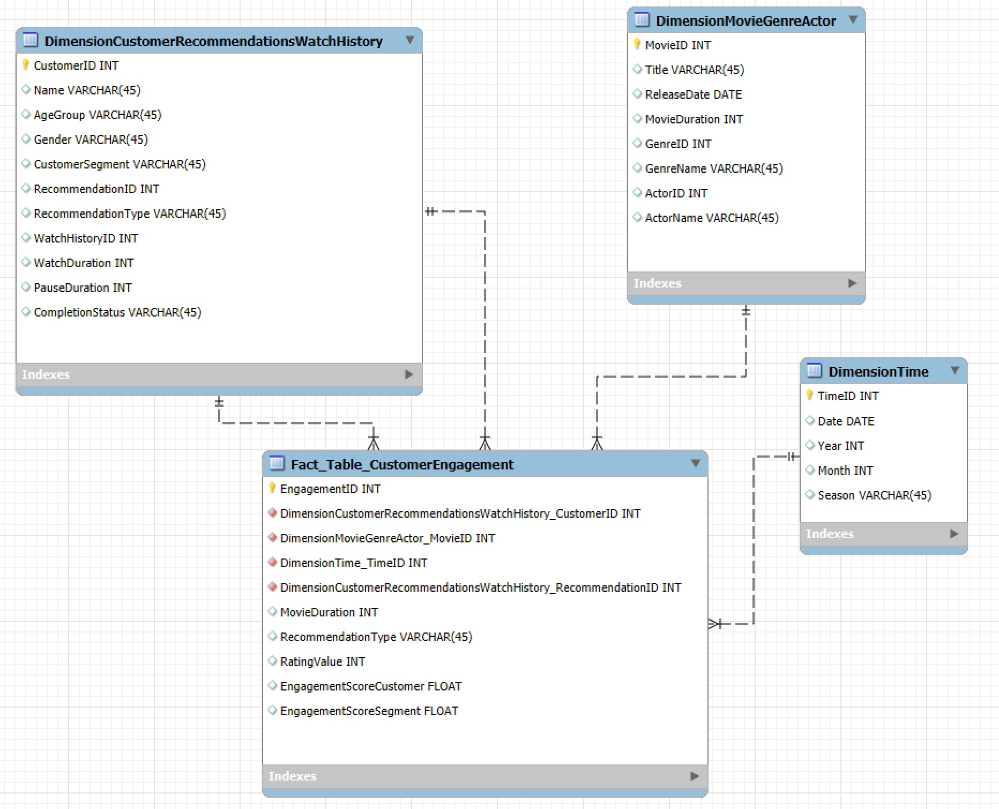

# Pathé Thuis — Data Warehouse + ETL + Recommendation Analytics (Pentaho + MySQL)

This repository documents an end-to-end **Business Intelligence / Data Engineering** case for the streaming platform **Pathé Thuis**.  
The goal was to support a **Customer Recommendation System (CRS)** by building a centralized **Data Warehouse (DW)**, implementing **ETL pipelines** (Pentaho Data Integration), and producing **analytics artifacts** (SQL view + Pentaho report) that improve personalization and curation.


---

## ✅ What this delivers
- Star Schema DW with **3 dimensions + 1 fact table**
- ETL implemented in **4 Pentaho PDI transformations**
- `PersonalizedRecommendations` SQL VIEW (filters **rating ≥ 4**, ranks by engagement)
- Pentaho report: **Top 10 Winter genres** by rating + watch duration


---

## 1) Motivation & Goal

Pathé Thuis aims to deliver a **highly personalized and engaging** streaming experience.  
To support this, the project builds a **Customer Recommendation System powered by a centralized Data Warehouse** that integrates:

- Customer demographics & subscription segment
- Recommendations served to customers (type/category)
- Watch history (watch + pause duration)
- Ratings
- Movie metadata (title, release date, duration)
- Genre + actor popularity context

Expected outcome: better **content personalization**, better **content curation**, improved **customer retention**.

---

## 2) Tech Stack

- **Database & Modeling:** MySQL, MySQL Workbench (`schemas/mysql_workbench/*.mwb`)
- **ETL / Data Integration:** Pentaho Data Integration (PDI / Spoon) (`pentaho/pdi_transformations/*.ktr`)
- **Reporting:** Pentaho Report Designer (`pentaho/reporting/*.prpt`)
- **Analytics SQL:** MySQL view for prioritized recommendations (`sql/*.sql`)
- **Input data:** CSV extracts representing an OLTP source system (`data/oltp_csv/*.csv`)

---

## 3) End-to-end flow

1. **OLTP data** loaded from CSV into MySQL tables (source system)
2. **Dimensional model (Star Schema)** created in MySQL (DW layer)
3. **ETL in Pentaho PDI** populates:
   - `DimensionTime`
   - `DimensionMovieGenreActor`
   - `DimensionCustomerRecommendationsWatchHistory`
   - `Fact_Table_CustomerEngagement`
4. **SQL VIEW** surfaces high-quality personalized recommendations (rating ≥ 4)
5. **Pentaho report** shows seasonal insight: **Top 10 Genres in Winter** by avg rating + total watch duration

---

## 4) Data Model

### 4.1 OLTP source (high level)
In the OLTP model, the relationships are:

- One **Customer** can receive many **Recommendations**, give many **Ratings**, and have many **WatchHistory** rows (one per watched movie).
- One **Movie** can be recommended to many customers, receive many ratings, and appear in many watch history rows.
- **Genre** categorizes movies.
- **Actor** is associated with movies.

The raw OLTP-style CSVs are in: `data/oltp_csv/`.

### 4.2 DW model choice: Star Schema
Star Schema was used for:
- simpler analytics
- improved query performance
- a clear view of the business process via a central fact table + surrounding dimensions

### 4.3 Star Schema diagram


---

## 5) DW Tables (columns + meaning)

Below are the DW table definitions used in this project.

### 5.1 Fact table — `Fact_Table_CustomerEngagement`
Captures customer interaction and perceived value over time (recommendations, ratings, engagement scores).  
All dimension tables are integrated into this fact table.

| Column | Type | Meaning |
|---|---|---|
| `EngagementID` | INT (PK) | Unique identifier for a customer engagement record |
| `CustomerLogsID` | INT (FK) | References customer log in `DimensionCustomerRecommendationsWatchHistory` |
| `MovieID` | INT (FK) | References the movie in `DimensionMovieGenreActor` |
| `TimeID` | INT (FK) | References time in `DimensionTime` |
| `MovieDuration` | INT | Movie duration in minutes |
| `RecommendationType` | VARCHAR | Recommendation category (e.g., Trending, Personal, New Release, Top Rated, Similar to Watched, Actor/Director Based) |
| `RatingValue` | INT | Customer score (e.g., 1–5) |
| `EngagementScoreCustomer` | FLOAT | **(WatchDuration / MovieDuration) × RatingValue** |
| `EngagementScoreSegment` | FLOAT | **SUM(EngagementScoreCustomer) / (# Customers in segment)** |

### 5.2 Dimension — `DimensionTime`
Stores date attributes and assigns months to seasons for seasonal pattern analysis.

| Column | Type | Meaning |
|---|---|---|
| `TimeID` | INT (PK) | Unique identifier for time record |
| `Date` | DATE | Full date |
| `Year` | INT | Year |
| `Month` | INT | Month number |
| `Season` | VARCHAR | Season label (Winter/Spring/Summer/Fall) |

**Season logic (implemented in PDI JS step):**
- Winter: Month = 12 OR Month ≤ 2
- Spring: Month ≤ 5
- Summer: Month ≤ 8
- Fall: otherwise

(See `pentaho/pdi_transformations/Trans_Dim_Time.ktr`.)

### 5.3 Dimension — `DimensionCustomerRecommendationsWatchHistory`
Enriches customers with subscription info + recommendation type + watch behavior + ratings.

| Column | Type | Meaning |
|---|---|---|
| `CustomerLogsID` | INT (PK) | Unique identifier for a combined “customer engagement log” |
| `CustomersID` | INT | Customer identifier |
| `Name` | VARCHAR | Customer name |
| `AgeGroup` | VARCHAR | Age group (Child/Teenager/Adult, etc.) |
| `Gender` | VARCHAR | Gender (Male/Female) |
| `CustomerSegment` | VARCHAR | Subscription segment (Standard/Economy/Premium) |
| `RecommendationID` | INT | Recommendation identifier |
| `RecommendationType` | VARCHAR | Recommendation category served |
| `WatchHistoryID` | INT | Watch history identifier |
| `WatchDuration` | INT | Minutes watched |
| `PauseDuration` | INT | Minutes paused |
| `CompletionStatus` | VARCHAR | Finished vs Unfinished |
| `MovieID` | INT | Movie identifier |
| `RatingValue` | INT | Rating given (1–5) |

**CompletionStatus logic (in PDI formula step):**
- If `WatchDuration > MovieDuration` → `"Finished"`  
- Else → `"Unfinished"`  

(See `pentaho/pdi_transformations/Trans_Dim_CusRecWatchhistory.ktr`.)

### 5.4 Dimension — `DimensionMovieGenreActor`
Integrates movie metadata with genre + actor information.

| Column | Type | Meaning |
|---|---|---|
| `MovieID` | INT (PK) | Unique identifier for movie |
| `Title` | VARCHAR | Movie title |
| `ReleaseDate` | DATE | Release date |
| `MovieDuration` | INT | Duration (minutes) |
| `GenreID` | INT | Genre identifier |
| `GenreName` | VARCHAR | Genre (Action, Comedy, etc.) |
| `ActorID` | INT | Actor identifier |
| `ActorName` | VARCHAR | Actor name |

---

## 6) ETL (Pentaho Data Integration)

ETL logic is implemented in the following transformations. The actual pipelines are provided as `.ktr` files in `pentaho/pdi_transformations/`.

### 6.1 Transformation: `Trans_Dim_CusRecWatchhistory.ktr`
**Output:** `DimensionCustomerRecommendationsWatchHistory`

**Purpose:** merge and enrich customer-level interaction data across:
- Customers
- Recommendations
- WatchHistory
- Movies (for MovieDuration)
- Ratings

**Core PDI operations used:**
- Sort Rows (alignment before joins)
- Stream Lookup (join keys like CustomerID, MovieID)
- Merge Join (combine streams deterministically)
- Formula transformation (derive `CompletionStatus`)
- Sequence (generate `CustomerLogsID`)
- Select Values (keep only relevant fields)
- Table Output (writes to DW table)

### 6.2 Transformation: `Trans_Dim_MovieGenreActor.ktr`
**Output:** `DimensionMovieGenreActor`

**Purpose:** enrich Movies with Genre + Actor attributes.

**Core PDI operations:**
- Table Input (Movies, Genres, Actors)
- Sort Rows
- Stream Lookup (GenreID → GenreName; ActorID → ActorName)
- Select Values (retain analytical attributes)
- Table Output

### 6.3 Transformation: `Trans_Dim_Time.ktr`
**Output:** `DimensionTime`

**Purpose:** generate and enrich a time dimension.

**Core PDI operations:**
- Row Generator (Generate Time)
- Sequence (assign `TimeID`)
- Calculator (base time calculations)
- Modified JavaScript Value (derive `Year`, `Month`, `Season`)
- Select Values (final cleanup)
- Table Output

### 6.4 Transformation: `Trans_FactTable.ktr`
**Output:** `Fact_Table_CustomerEngagement`

**Purpose:** integrate the dimensions into the central fact table and compute engagement metrics.

**Key derived measures (transformation logic):**
- `EngagementScoreCustomer = (WatchDuration / MovieDuration) * RatingValue`
- `EngagementScoreSegment = SumEngagementScoreCustomer / SumCustomersPerSegment`

**Core PDI operations:**
- Stream Lookup (connect fact rows to dimension keys/attributes)
- Formula (compute `EngagementScoreCustomer`)
- Memory Group By (segment-level aggregates)
- Calculator (divide for `EngagementScoreSegment`)
- Sequence (generate `EngagementID`)
- Table Output

---

## 7) SQL View — Personalized Recommendations (rating ≥ 4)

This SQL VIEW surfaces movies with rating ≥ 4, sorted by engagement.

File: `sql/create_view_personalized_recommendations.sql`

```sql
CREATE VIEW pathe.PersonalizedRecommendations AS
SELECT 
    dc.Name AS CustomerName,
    dm.Title AS MovieTitle,
    dm.GenreName AS Genre,
    dm.ReleaseDate,
    ft.EngagementScoreCustomer AS EngagementScore,  
    AVG(ft.RatingValue) AS AverageRating
FROM 
    pathe.DimensionCustomerRecommendationsWatchHistory dc
JOIN 
    pathe.Fact_Table_CustomerEngagement ft
    ON dc.CustomerLogsID = ft.CustomerLogsID  
JOIN 
    pathe.DimensionMovieGenreActor dm
    ON ft.MovieID = dm.MovieID
WHERE 
    ft.RatingValue >= 4 
GROUP BY 
    dc.Name, 
    dm.Title, 
    dm.GenreName, 
    dm.ReleaseDate, 
    ft.EngagementScoreCustomer  
ORDER BY 
    ft.EngagementScoreCustomer DESC,  
    AverageRating DESC;
```

**What it achieves:**
- prioritizes **highly rated** titles (rating ≥ 4)
- orders by **EngagementScoreCustomer** and then average rating
- supports personalization (genre / release-driven selection) while using actual engagement behavior

---

## 8) Report — Top 10 Genres in Winter

This report shows a Pentaho Report Designer output:

**Report file:**  
`pentaho/reporting/TOP 10 Genres based on both average rating and total watch duration for season Winter.prpt`

**Goal:**
- Retrieve the **Top 10 most popular genres during Winter**
- Popularity is based on:
  - **AverageRating** (avg user rating per genre)
  - **TotalWatchDuration** (sum of watch duration per genre)
- Sort descending by AverageRating, and break ties with TotalWatchDuration
- Display only top 10 genres

---

## 9) How to reproduce (local)

### Prerequisites
- MySQL Server (and optionally MySQL Workbench)
- Pentaho Data Integration (Spoon)
- Pentaho Report Designer

### Step-by-step
1. **Create database**
   - Create a MySQL database named `pathe`.

2. **Create OLTP + DW tables**
   - Open the Workbench models:
     - `schemas/mysql_workbench/Pathe_OLTP_Schema.mwb`
     - `schemas/mysql_workbench/Pathe_DW_Schema.mwb`
   - Forward engineer / export SQL to create the tables in MySQL.

3. **Load OLTP data**
   - Import CSVs from `data/oltp_csv/` into their corresponding OLTP tables:
     - `actors.csv`, `genres.csv`, `moviemocsv.csv`, `customer.csv`, `Recommendations.csv`, `Watchhistory.csv`, `Rating.csv`

4. **Run PDI transformations (order matters)**
   - In Spoon, open and run:
     1) `pentaho/pdi_transformations/Trans_Dim_Time.ktr`
     2) `pentaho/pdi_transformations/Trans_Dim_MovieGenreActor.ktr`
     3) `pentaho/pdi_transformations/Trans_Dim_CusRecWatchhistory.ktr`
     4) `pentaho/pdi_transformations/Trans_FactTable.ktr`
   - Ensure each transformation uses a valid MySQL connection to database `pathe`.

5. **Create the recommendation view**
   - Run `sql/create_view_personalized_recommendations.sql` in MySQL.

6. **Open the report**
   - Open the `.prpt` file in Pentaho Report Designer
   - Update the MySQL connection if needed (host/user/password)
   - Preview / run the report

---

## 10) Repository Structure

```
.
├── README.md
├── assets/
│   └── DW.png
├── data/
│   └── oltp_csv/
│       ├── actors.csv
│       ├── customer.csv
│       ├── genres.csv
│       ├── moviemocsv.csv
│       ├── Rating.csv
│       ├── Recommendations.csv
│       └── Watchhistory.csv
├── schemas/
│   └── mysql_workbench/
│       ├── Pathe_DW_Schema.mwb
│       └── Pathe_OLTP_Schema.mwb
├── pentaho/
│   ├── pdi_transformations/
│   │   ├── Trans_Dim_CusRecWatchhistory.ktr
│   │   ├── Trans_Dim_MovieGenreActor.ktr
│   │   ├── Trans_Dim_Time.ktr
│   │   └── Trans_FactTable.ktr
│   └── reporting/
│       └── TOP 10 Genres based on both average rating and total watch duration for season Winter.prpt
└── sql/
    └── create_view_personalized_recommendations.sql
```

---

## Notes 

- This is a **course-style case** built from provided CSVs; the “recommendation system” here is implemented as a **DW + analytics layer** that supports recommendation decisions (it is not a production recommender model).